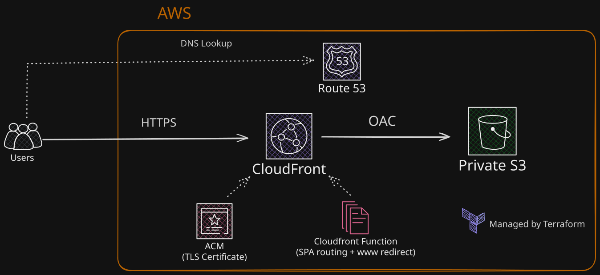

# vladlenski

An AWS-hosted portfolio website used as a practical cloud engineering project.
The repository demonstrates infrastructure as code, secure cloud configuration
and deployment automation, with a React frontend as its first workload.

**[Live website](https://gavronski.dev)** ·
**[Infrastructure case study](https://gavronski.dev/infrastructure)**

The case study explains the engineering decisions, implementation challenges and
selected evidence. This README covers the repository and local development.

## Architecture overview



Route 53 resolves the custom domain to CloudFront. CloudFront serves HTTPS using
an ACM certificate and retrieves static Vite build output from a private S3
origin through Origin Access Control (OAC).

A viewer-request CloudFront Function redirects `www` to the apex domain and
rewrites the known React Router paths to `index.html`. Unknown paths remain
unchanged, so missing assets are not silently returned as application HTML.

Production hosting uses CloudFront and private S3. CI builds the optional
Docker/Nginx image but does not test its container runtime.

See the [Infrastructure case study](https://gavronski.dev/infrastructure) for the
architecture rationale, or browse the [editable diagram sources](docs/diagrams/)
and [detailed AWS diagram](frontend/src/assets/aws-infrastructure.svg).

## Repository structure

```text
.
├── .devcontainer/           # Development environment configuration
├── .github/workflows/      # CI, production deployment and OIDC identity check
├── docs/diagrams/           # Editable Excalidraw diagram sources
├── frontend/               # React application, Vite configuration and Dockerfile
│   └── src/
│       ├── assets/          # SVG diagrams and selected implementation evidence
│       ├── components/      # Reusable UI
│       └── pages/           # Portfolio pages, including the Infrastructure case study
└── infrastructure/         # Application infrastructure and deployment identity
    └── bootstrap/          # Independent Terraform root for the state bucket
```

Start with the [frontend](frontend/), [application Terraform root](infrastructure/)
or [bootstrap root](infrastructure/bootstrap/). The automation entry points are
[Frontend CI](.github/workflows/frontend-ci.yml) and
[Frontend Deploy](.github/workflows/frontend-deploy.yml).

## Current capabilities

| Area | Implementation |
| --- | --- |
| Frontend | React, TypeScript and Vite, with React Router navigation |
| Infrastructure | Terraform-managed S3, CloudFront, Route 53, ACM and deployment IAM resources |
| State | Separate bootstrap and application roots; application state in S3 with native locking |
| Origin access | Private S3 bucket with public access blocked and distribution-scoped OAC access |
| Automation | GitHub Actions for automatic CI and manually triggered production deployment |
| Deployment identity | GitHub OIDC and temporary AWS credentials, with scoped deployment permissions |
| Development | VS Code Dev Container with Node.js, Terraform, AWS CLI and TFLint |

## Local development

Use VS Code with Docker and the Dev Containers extension. After cloning, open the
repository and select **Dev Containers: Reopen in Container**.
The [container configuration](.devcontainer/devcontainer.json) installs frontend
dependencies with `npm ci` during creation and forwards port 5173.

From the repository root, start the frontend:

```bash
cd frontend
npm run dev
```

Open the forwarded development URL, normally `http://localhost:5173`.
No AWS authentication is needed for frontend development.

To install dependencies manually or refresh them from the lockfile, run
`npm ci` from `frontend/` before starting the server.

The Dev Container uses Node.js 22; GitHub Actions and the Docker builder use
Node.js 24. Their configuration is versioned in the repository.

## Validation

### Frontend

From `frontend/`, after installing dependencies:

```bash
npm run lint
npm run build
```

These run ESLint, TypeScript compilation and the Vite production build.
The generated static files are written to `frontend/dist/`.

If Docker CLI and daemon access are available, also check the image build from
`frontend/`:

```bash
docker build -t vladlenski-frontend .
```

Docker access inside the Dev Container requires separate configuration.
Building the image does not execute browser or container runtime tests.

### Terraform

Both roots require Terraform `>= 1.15.0, < 2.0.0`. Run these commands from the
repository root inside the Dev Container.

For configuration validation on a fresh clone, install providers without
initialising the application's remote backend:

```bash
terraform -chdir=infrastructure fmt -check
terraform -chdir=infrastructure init -backend=false
terraform -chdir=infrastructure validate
```

Validate the independent bootstrap root separately:

```bash
terraform -chdir=infrastructure/bootstrap fmt -check
terraform -chdir=infrastructure/bootstrap init -backend=false
terraform -chdir=infrastructure/bootstrap validate
```

Provider installation needs network access. These checks need no authenticated
AWS access and do not evaluate live infrastructure. `fmt -check` reports
formatting differences without rewriting files.

Backend-free initialisation is only preparation for validation. Authenticated
work with the main root requires normal S3 backend initialisation using the
intended SSO profile and access to the existing backend. The backend configuration
is specific to this deployment; cloning the repository does not grant access.

## CI and production deployment

### Frontend CI

[Frontend CI](.github/workflows/frontend-ci.yml) runs automatically on pushes to
`main` and pull requests targeting `main`. It installs dependencies, runs ESLint,
compiles and builds the frontend, then builds the Docker image.

The Docker step validates the image build; it does not run application tests
inside the container.

### Production deployment

[Frontend Deploy](.github/workflows/frontend-deploy.yml) is manually triggered
through `workflow_dispatch` on `main`, using the `production` environment.
It defaults to `dry_run: true`, which previews uploads without publishing files,
invalidating CloudFront or performing live release verification.

The workflow installs dependencies, lints and builds the selected revision,
validates the generated files, then authenticates through GitHub OIDC to obtain
temporary AWS credentials. Deployment permissions are scoped to the frontend
bucket and the required CloudFront invalidation operations.

With `dry_run: false`, it uploads hashed assets first, other static files next
and HTML last, then creates targeted CloudFront invalidations and waits for
completion. It verifies published files and supported routes over HTTPS against
the build output.

Deployment repeats lint and build checks independently; it does not enforce a
successful separate CI run as a prerequisite. Live content verification checks
HTTP delivery and file contents, rather than browser rendering or interaction.

## Terraform and AWS boundaries

The [main root](infrastructure/) manages application infrastructure and the GitHub
deployment identity. Its [S3 backend](infrastructure/backend.tf) uses encryption
and S3-native state locking. The [bootstrap root](infrastructure/bootstrap/)
provisions the state bucket independently and retains local Terraform state.

Infrastructure administration uses IAM Identity Center (SSO) and temporary
credentials rather than long-lived IAM user keys. Check the active AWS account
and role before authenticated infrastructure operations, and review the complete
Terraform plan before authorising changes.

Cloning this repository grants no access to the production AWS account or
Terraform state. Configuration validation does not establish the live AWS state.

Keep state, saved plans and credentials out of Git. State and plans can contain
sensitive data; ignore rules do not cover every possible plan filename. Bootstrap
local state also needs secure handling and backup.

## Limitations and further documentation

There is no automated frontend application test suite. The deployment workflow
supports rebuilding an earlier commit, but a full production rollback and
recovery scenario has not yet been exercised. Basic monitoring is a possible
future enhancement.

The [Infrastructure case study](https://gavronski.dev/infrastructure) covers
design decisions, deployment mechanics, troubleshooting and selected evidence.
Its [page source](frontend/src/pages/Infrastructure.tsx),
[CI/CD diagram](frontend/src/assets/cicd-deployment.svg) and
[diagram sources](docs/diagrams/) provide further reference. The case study is
explanatory documentation, not a complete operational runbook.
